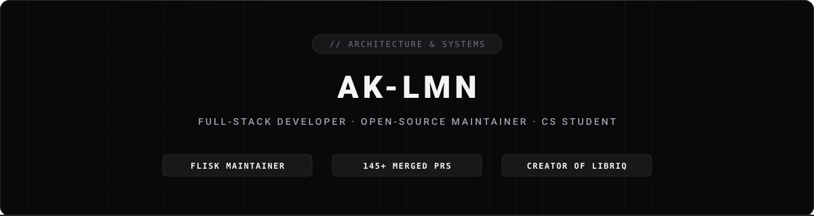

<div align="center">



<br/><br/>

[](https://github.com/flisk-sh/flisk/issues/1164)
[](https://github.com/AK-Lmn)
[](https://hub.xerj.org/contributors/AK-Lmn)
[](https://github.com/sponsors/AK-Lmn)
[](https://ko-fi.com/aklmn)

<br/><br/>

Building developer tooling, runtime engines, and offline-first architectures.

<br/>

[Portfolio](https://aklmn.me) &nbsp;·&nbsp; [LinkedIn](https://www.linkedin.com/in/kim-lamano) &nbsp;·&nbsp; [GitHub Sponsors](https://github.com/sponsors/AK-Lmn) &nbsp;·&nbsp; [Ko-fi](https://ko-fi.com/aklmn)

</div>

<br/>

### [01] PROFILE

- `›` **Focus**: Architecting [LibriQ](https://libriq.app) (3D digital library) and core developer runtime tooling.
- `›` **Open Source**: Flisk Maintainer across 66 repositories; 148+ merged PRs across open-source ecosystems.
- `›` **Recognition**: Selected by [XERJ Corpus Hub](https://hub.xerj.org/contributors/AK-Lmn) (4.2k+ stars) as an open-source reference solution.
- `›` **Education**: 2nd Year Computer Science student at Lyceum of Alabang.

---

### [02] FEATURED PROJECTS

<table width="100%">
  <tr>
    <td width="50%" valign="top">
      <h4><b>PoopPal</b> &nbsp;·&nbsp; <code>Android · Capacitor</code></h4>
      <p>Habit tracking Android app built with React 19, TypeScript, Capacitor, and Firebase Firestore. Features real-time duo sync, 2x2 home widgets, Quick Settings tile, and procedural chiptune synth.</p>
      <p>
        <a href="https://github.com/AK-Lmn/PoopPal/releases/tag/v1.0.0"><b>Download APK (v1.0.0)</b></a> &nbsp;·&nbsp; 
        <a href="https://github.com/AK-Lmn/PoopPal">Source</a>
      </p>
    </td>
    <td width="50%" valign="top">
      <h4><b>LibriQ</b> &nbsp;·&nbsp; <code>Three.js · PWA</code></h4>
      <p>Personal 3D digital bookshelf and reading tracker. Features interactive Three.js 3D shelf rendering, RFC 4180 Goodreads and Kindle CSV data pipeline, and offline-first PWA caching.</p>
      <p>
        <a href="https://libriq.app"><b>Live Application</b></a> &nbsp;·&nbsp; 
        <a href="https://github.com/AK-Lmn/Libriq">Source</a>
      </p>
    </td>
  </tr>
  <tr>
    <td width="50%" valign="top">
      <h4><b>Flisk CLI Core</b> &nbsp;·&nbsp; <code>Runtime · Systems</code></h4>
      <p>Local multi-service runtime engine. Engineered Tiltfile and Compose import subcommands (#2238, #2239), optional Traefik gateway and Postgres (#2232, #2233), AI Agent control plane (<code>tdk mcp</code>), and machine envelope outputs (#707).</p>
      <p>
        <a href="https://github.com/flisk-sh/flisk"><b>Repository</b></a> &nbsp;·&nbsp; 
        <a href="https://github.com/flisk-sh/flisk/pulls?q=is%3Apr+author%3AAK-Lmn+is%3Amerged">Merged PRs (68)</a>
      </p>
    </td>
    <td width="50%" valign="top">
      <h4><b>Lokal.MD</b> &nbsp;·&nbsp; <code>Python · EHR</code></h4>
      <p>Philippine clinical EHR vault and offline Taglish speech-to-text clinical transcription system for Rural Health Units (RHU). Built with deterministic PNF safety engines and AES-256-GCM.</p>
      <p>
        <a href="https://github.com/AK-Lmn/lokal-md"><b>Source</b></a> &nbsp;·&nbsp; 
        <i>AppBuildersPH Hackathon</i>
      </p>
    </td>
  </tr>
</table>

---

### [03] OPEN SOURCE IMPACT

- **flisk-sh/flisk**: Shipped import commands (`tiltfile`, `compose`), configurable gateways, and runtime tests.
- **xerj-org/xerj**: Documented 26 agent harness configurations and execution contracts.
- **determined-001/Quay**: Hardened mainnet secret generator and quote validators.
- **oll4com/spaceapp**: Unified distributed tracing and child-workflow spans over OTLP.

<details>
<summary><b>Complete Pull Request Log (148+ Merged PRs across 25+ Ecosystems)</b></summary>
<br/>

#### [`flisk-sh/flisk`](https://github.com/flisk-sh/flisk)
`›` `[FEAT]` &nbsp;·&nbsp; [flisk version --verbose prints the git commit the package was built from (Fixes #3096)](https://github.com/flisk-sh/flisk/pull/3195)<br/>
`›` `[FEAT]` &nbsp;·&nbsp; [command on a service that also has build (Fixes #3060)](https://github.com/flisk-sh/flisk/pull/3194)<br/>
`›` `[TEST]` &nbsp;·&nbsp; [cover cli/src/commands/ui.tsx (Fixes #3112)](https://github.com/flisk-sh/flisk/pull/3193)<br/>
`›` `[FEAT]` &nbsp;·&nbsp; [add flisk import tiltfile subcommand (#2239)](https://github.com/flisk-sh/flisk/pull/2849)<br/>
`›` `[FEAT]` &nbsp;·&nbsp; [make database optional via with_db toggle (#2233)](https://github.com/flisk-sh/flisk/pull/2854)<br/>
`›` `[FEAT]` &nbsp;·&nbsp; [make gateway optional via with_gateway toggle (#2232)](https://github.com/flisk-sh/flisk/pull/2853)<br/>
`›` `[FEAT]` &nbsp;·&nbsp; [make health checks optional and configurable (#2235)](https://github.com/flisk-sh/flisk/pull/2852)<br/>
`›` `[FEAT]` &nbsp;·&nbsp; [add flisk import compose subcommand (#2238)](https://github.com/flisk-sh/flisk/pull/2848)<br/>
`›` `[TEST]` &nbsp;·&nbsp; [add test for hacktoberfest-embed.mjs (Fixes #2323)](https://github.com/flisk-sh/flisk/pull/2844)<br/>
`›` `[TEST]` &nbsp;·&nbsp; [add behaviour test for wsl2-smoke.sh (Fixes #2366)](https://github.com/flisk-sh/flisk/pull/2845)<br/>
`›` `[TEST]` &nbsp;·&nbsp; [add test for npm-downloads-graph.mjs (Fixes #2322)](https://github.com/flisk-sh/flisk/pull/2843)<br/>
`›` `[TEST]` &nbsp;·&nbsp; [add test for demo-svgs.mjs (Fixes #2328)](https://github.com/flisk-sh/flisk/pull/2842)<br/>
`›` `[TEST]` &nbsp;·&nbsp; [add behaviour test for setup-pre-commit.sh (Fixes #2331)](https://github.com/flisk-sh/flisk/pull/2841)<br/>
`›` `[FIX]` &nbsp;·&nbsp; [preserve hooks when .githooks is absent](https://github.com/flisk-sh/flisk/pull/2710)<br/>
`›` `[TEST]` &nbsp;·&nbsp; [add behaviour test for sync-byo-templates.sh (Fixes #2368)](https://github.com/flisk-sh/flisk/pull/2660)<br/>
`›` `[TEST]` &nbsp;·&nbsp; [add behaviour test for package-lifecycle-smoke.sh (Fixes #2370)](https://github.com/flisk-sh/flisk/pull/2659)<br/>
`›` `[TEST]` &nbsp;·&nbsp; [add behaviour test for cold-boot-notes.sh (Fixes #2369)](https://github.com/flisk-sh/flisk/pull/2658)<br/>
`›` `[TEST]` &nbsp;·&nbsp; [add behaviour test for release-binaries.sh (Fixes #2372)](https://github.com/flisk-sh/flisk/pull/2657)<br/>
`›` `[TEST]` &nbsp;·&nbsp; [add behaviour test for audit-codebase.sh (Fixes #2371)](https://github.com/flisk-sh/flisk/pull/2656)<br/>
`›` `[TEST]` &nbsp;·&nbsp; [add tests for up-only shared infrastructure list (#2430)](https://github.com/flisk-sh/flisk/pull/2493)<br/>
`›` `[TEST]` &nbsp;·&nbsp; [cover Traefik ingress rows in status-ports (#2427)](https://github.com/flisk-sh/flisk/pull/2492)<br/>
`›` `[TEST]` &nbsp;·&nbsp; [pin TRAEFIK network and ports in platform-standards (#2428)](https://github.com/flisk-sh/flisk/pull/2491)<br/>
`›` `[TEST]` &nbsp;·&nbsp; [cover Traefik network marker check in down-cleanup (#2426)](https://github.com/flisk-sh/flisk/pull/2490)<br/>
`›` `[TEST]` &nbsp;·&nbsp; [expand coverage for the generator template engine (#1553)](https://github.com/flisk-sh/flisk/pull/1866)<br/>
`›` `[TEST]` &nbsp;·&nbsp; [cover service URL generation and runtime state edges (#1593)](https://github.com/flisk-sh/flisk/pull/1865)<br/>
`›` `[TEST]` &nbsp;·&nbsp; [cover custom agent runtime handling (#1552)](https://github.com/flisk-sh/flisk/pull/1864)<br/>
`›` `[TEST]` &nbsp;·&nbsp; [add unit tests for services metadata, stack metadata, and discovery problems (#1583)](https://github.com/flisk-sh/flisk/pull/1808)<br/>
`›` `[TEST]` &nbsp;·&nbsp; [add unit tests for startup report dependency cycles and empty payloads (#1578)](https://github.com/flisk-sh/flisk/pull/1809)<br/>
`›` `[TEST]` &nbsp;·&nbsp; [add unit tests for generator extension fetcher (#1571)](https://github.com/flisk-sh/flisk/pull/1769)<br/>
`›` `[TEST]` &nbsp;·&nbsp; [add unit test for cache module (#1570)](https://github.com/flisk-sh/flisk/pull/1754)<br/>
`›` `[TEST]` &nbsp;·&nbsp; [add unit tests for doctor command (#1569)](https://github.com/flisk-sh/flisk/pull/1742)<br/>
`›` `[TEST]` &nbsp;·&nbsp; [add unit tests for config-cleaner (#1568)](https://github.com/flisk-sh/flisk/pull/1741)<br/>
`›` `[TEST]` &nbsp;·&nbsp; [add unit test for clean-cli (#1567)](https://github.com/flisk-sh/flisk/pull/1740)<br/>
`›` `[TEST]` &nbsp;·&nbsp; [add unit tests for manifest-cleaner (#1566)](https://github.com/flisk-sh/flisk/pull/1738)<br/>
`›` `[TEST]` &nbsp;·&nbsp; [add unit test for file-utils (#1565)](https://github.com/flisk-sh/flisk/pull/1736)<br/>
`›` `[TEST]` &nbsp;·&nbsp; [add unit test for env-loader (#1564)](https://github.com/flisk-sh/flisk/pull/1733)<br/>
`›` `[TEST]` &nbsp;·&nbsp; [add unit test for base-cleaner (#1563)](https://github.com/flisk-sh/flisk/pull/1731)<br/>
`›` `[TEST]` &nbsp;·&nbsp; [add unit test for alias-resolver (#1562)](https://github.com/flisk-sh/flisk/pull/1728)<br/>
`›` `[DOCS]` &nbsp;·&nbsp; [write docs/comparison.md comparing TDK with alternative dev tools (#105)](https://github.com/flisk-sh/flisk/pull/1684)<br/>
`›` `[DOCS]` &nbsp;·&nbsp; [add getting help, supported platforms, and TOC to CONTRIBUTING (#98)](https://github.com/flisk-sh/flisk/pull/1683)<br/>
`›` `[DOCS]` &nbsp;·&nbsp; [add root AGENTS.md for AI coding agents (#92)](https://github.com/flisk-sh/flisk/pull/1682)<br/>
`›` `[REFACTOR]` &nbsp;·&nbsp; [standardise error message style and document exit code rules (#708)](https://github.com/flisk-sh/flisk/pull/1620)<br/>
`›` `[REFACTOR]` &nbsp;·&nbsp; [standardise -y/--yes and --force flags across commands (#706)](https://github.com/flisk-sh/flisk/pull/1619)<br/>
`›` `[FEAT]` &nbsp;·&nbsp; [add --all flag with Machine/Project sections and summary (#86)](https://github.com/flisk-sh/flisk/pull/1618)<br/>
`›` `[TEST]` &nbsp;·&nbsp; [verify --json check shapes and document flag in cli/README.md (#87)](https://github.com/flisk-sh/flisk/pull/1617)<br/>
`›` `[FEAT]` &nbsp;·&nbsp; [enforce core version gate and upgrade recommendation (#634)](https://github.com/flisk-sh/flisk/pull/1365)<br/>
`›` `[DOCS]` &nbsp;·&nbsp; [structure framework version table and tidy spacing (#813)](https://github.com/flisk-sh/flisk/pull/1353)<br/>
`›` `[DOCS]` &nbsp;·&nbsp; [document resource features and featuresEnabled array (#127)](https://github.com/flisk-sh/flisk/pull/1351)<br/>
`›` `[DOCS]` &nbsp;·&nbsp; [write docs/how-tdk-up-works.md explaining lifecycle, flags, and down (#101)](https://github.com/flisk-sh/flisk/pull/1350)<br/>
`›` `[DOCS]` &nbsp;·&nbsp; [write docs/ARCHITECTURE.md explaining CLI, engine, and discovery (#99)](https://github.com/flisk-sh/flisk/pull/1349)<br/>
`›` `[FEAT]` &nbsp;·&nbsp; [add node as a native backend language provider (#110)](https://github.com/flisk-sh/flisk/pull/1276)<br/>
`›` `[FEAT]` &nbsp;·&nbsp; [press 'o' to open resource URL in browser and 'y' to copy it (#456)](https://github.com/flisk-sh/flisk/pull/1269)<br/>
`›` `[FEAT]` &nbsp;·&nbsp; [add agent directives, skills, and agent-stack template (#1256 part D)](https://github.com/flisk-sh/flisk/pull/1264)<br/>
`›` `[FEAT]` &nbsp;·&nbsp; [add agent control tools and CLI commands (#1256 part C)](https://github.com/flisk-sh/flisk/pull/1263)<br/>
`›` `[FEAT]` &nbsp;·&nbsp; [add postgres durability session store (#1256)](https://github.com/flisk-sh/flisk/pull/1262)<br/>
`›` `[REFACTOR]` &nbsp;·&nbsp; [standardise machine envelope construction in machine-output (#707)](https://github.com/flisk-sh/flisk/pull/1261)<br/>
`›` `[DOCS]` &nbsp;·&nbsp; [position TDK for the AI-agent era (#1256 part A)](https://github.com/flisk-sh/flisk/pull/1260)<br/>
`›` `[DOCS]` &nbsp;·&nbsp; [document tdk up --json readiness result contract (#1195)](https://github.com/flisk-sh/flisk/pull/1226)<br/>
`›` `[FIX]` &nbsp;·&nbsp; [do not pass --force to tilt down (#1216)](https://github.com/flisk-sh/flisk/pull/1225)<br/>
`›` `[REFACTOR]` &nbsp;·&nbsp; [use constant for project.json file name (#905)](https://github.com/flisk-sh/flisk/pull/950)<br/>
`›` `[REFACTOR]` &nbsp;·&nbsp; [use constant for TILT_TECH_STACK.star file name (#908)](https://github.com/flisk-sh/flisk/pull/949)<br/>
`›` `[REFACTOR]` &nbsp;·&nbsp; [use constant for TILT_RESOURCE_DEFAULTS.star file name (#909)](https://github.com/flisk-sh/flisk/pull/948)<br/>
`›` `[REFACTOR]` &nbsp;·&nbsp; [use constant for .autogenerated directory name (#907)](https://github.com/flisk-sh/flisk/pull/947)<br/>
`›` `[REFACTOR]` &nbsp;·&nbsp; [constant for the package.json file name (#906)](https://github.com/flisk-sh/flisk/pull/946)<br/>
`›` `[REFACTOR]` &nbsp;·&nbsp; [constant for the docker-compose.yml file name (#910)](https://github.com/flisk-sh/flisk/pull/945)<br/>
`›` `[DOCS]` &nbsp;·&nbsp; [document up, down and status flags](https://github.com/flisk-sh/flisk/pull/660)<br/>
`›` `[DOCS]` &nbsp;·&nbsp; [document tdk doctor --no-ping and --ping-timeout flags](https://github.com/flisk-sh/flisk/pull/659)<br/>
`›` `[TEST]` &nbsp;·&nbsp; [cover env-validator utility functions](https://github.com/flisk-sh/flisk/pull/658)<br/>

#### [`xerj-org/xerj`](https://github.com/xerj-org/xerj)
`›` `[DOCS]` &nbsp;·&nbsp; [list 26 supported agent harnesses with config file, key and tested status (#1991)](https://github.com/xerj-org/xerj/pull/2109)<br/>

#### [`oll4com/spaceapp`](https://github.com/oll4com/spaceapp)
`›` `[FEAT]` &nbsp;·&nbsp; [connect API, workflow, child-workflow and activity spans over OTLP (#61)](https://github.com/oll4com/spaceapp/pull/217)<br/>

#### [`determined-001/Quay`](https://github.com/determined-001/Quay)
`›` `[FIX]` &nbsp;·&nbsp; [stop generating DEFAULT_SELLER keys in gen-mainnet-secrets (#417)](https://github.com/determined-001/Quay/pull/426)<br/>
`›` `[FIX]` &nbsp;·&nbsp; [validate and normalize targetCurrency on cash-out quote route (#412)](https://github.com/determined-001/Quay/pull/425)<br/>

#### [`nikolas-sapa/ns-ui`](https://github.com/nikolas-sapa/ns-ui)
`›` `[DOCS]` &nbsp;·&nbsp; [refresh stale component counts in live code comments (#87)](https://github.com/nikolas-sapa/ns-ui/pull/87)<br/>

#### [`SumantxD/shrike`](https://github.com/SumantxD/shrike)
`›` `[FIX]` &nbsp;·&nbsp; [stop polling for spec indefinitely and use finite backoff (#49)](https://github.com/SumantxD/shrike/pull/49)<br/>

#### [`brekkylab/backlot`](https://github.com/brekkylab/backlot)
`›` `[CONTRIB]` &nbsp;·&nbsp; [notion: a person's person member includes email_verified](https://github.com/brekkylab/backlot/pull/635)<br/>
`›` `[CONTRIB]` &nbsp;·&nbsp; [s3: object GET and HEAD send default AES256 server-side encryption on...](https://github.com/brekkylab/backlot/pull/600)<br/>
`›` `[CONTRIB]` &nbsp;·&nbsp; [jira: serverInfo lists its members in real's order](https://github.com/brekkylab/backlot/pull/519)<br/>

#### [`sungeer/graph`](https://github.com/sungeer/graph)
`›` `[FIX]` &nbsp;·&nbsp; [add requirements.txt, fix uvicorn command, and update setup docs](https://github.com/sungeer/graph/pull/1)<br/>

#### [`anoopcodehack/DevBoard`](https://github.com/anoopcodehack/DevBoard)
`›` `[FEAT]` &nbsp;·&nbsp; [add flip animation when task status changes (#545)](https://github.com/anoopcodehack/DevBoard/pull/570)<br/>
`›` `[FEAT]` &nbsp;·&nbsp; [show previous assignees on task card and modal (#564)](https://github.com/anoopcodehack/DevBoard/pull/569)<br/>
`›` `[FEAT]` &nbsp;·&nbsp; [add subtle status-based tints to task cards (#488)](https://github.com/anoopcodehack/DevBoard/pull/568)<br/>
`›` `[FEAT]` &nbsp;·&nbsp; [export task details as Markdown file (#526)](https://github.com/anoopcodehack/DevBoard/pull/567)<br/>
`›` `[FEAT]` &nbsp;·&nbsp; [add font size toggle on code snippets (#565)](https://github.com/anoopcodehack/DevBoard/pull/566)<br/>

#### [`embedcatalog/embedcatalog`](https://github.com/embedcatalog/embedcatalog)
`›` `[FEAT]` &nbsp;·&nbsp; [make tags clickable in Other Projects section](https://github.com/embedcatalog/embedcatalog/pull/20)<br/>
`›` `[FEAT]` &nbsp;·&nbsp; [make project tags clickable with search filter](https://github.com/embedcatalog/embedcatalog/pull/19)<br/>
`›` `[FIX]` &nbsp;·&nbsp; [remove underline on link hover in submit page](https://github.com/embedcatalog/embedcatalog/pull/18)<br/>
`›` `[FEAT]` &nbsp;·&nbsp; [add scroll to top button](https://github.com/embedcatalog/embedcatalog/pull/17)<br/>
`›` `[CONTRIB]` &nbsp;·&nbsp; [Add search component to embeds page (#2)](https://github.com/embedcatalog/embedcatalog/pull/5)<br/>

#### [`FixITSukil/findmy-trail`](https://github.com/FixITSukil/findmy-trail)
`›` `[FIX]` &nbsp;·&nbsp; [apply focus rings, aria-labels, text contrast, and semantic close button (#27)](https://github.com/FixITSukil/findmy-trail/pull/28)<br/>
`›` `[FEAT]` &nbsp;·&nbsp; [implement live trail statistics panel inside sidebar dashboard](https://github.com/FixITSukil/findmy-trail/pull/26)<br/>
`›` `[FEAT]` &nbsp;·&nbsp; [sync map layer tiles dynamically with application theme toggle](https://github.com/FixITSukil/findmy-trail/pull/25)<br/>
`›` `[FEAT]` &nbsp;·&nbsp; [add timeline playback scrubber controls for tracking simulation](https://github.com/FixITSukil/findmy-trail/pull/24)<br/>
`›` `[FEAT]` &nbsp;·&nbsp; [add date range filter listeners and real-time layout updates](https://github.com/FixITSukil/findmy-trail/pull/18)<br/>
`›` `[FEAT]` &nbsp;·&nbsp; [support Google Takeout Records.json timeline format auto-detection](https://github.com/FixITSukil/findmy-trail/pull/17)<br/>
`›` `[FEAT]` &nbsp;·&nbsp; [implement full keyboard navigation and accessibility enhancements](https://github.com/FixITSukil/findmy-trail/pull/16)<br/>
`›` `[FEAT]` &nbsp;·&nbsp; [implement comprehensive Google Maps Timeline JSON parser](https://github.com/FixITSukil/findmy-trail/pull/6)<br/>

#### [`TechGenDM/OpenField`](https://github.com/TechGenDM/OpenField)
`›` `[FEAT]` &nbsp;·&nbsp; [add client-side markdown and json report export (#1)](https://github.com/TechGenDM/OpenField/pull/6)<br/>

#### [`StackGuardian/tirith`](https://github.com/StackGuardian/tirith)
`›` `[TEST]` &nbsp;·&nbsp; [cover IsEmpty and IsNotEmpty on 0, False and whitespace](https://github.com/StackGuardian/tirith/pull/409)<br/>

#### [`TheVicky1/Pact_OS`](https://github.com/TheVicky1/Pact_OS)
`›` `[TEST]` &nbsp;·&nbsp; [write comprehensive unit test suite for number range clamp helper (#431)](https://github.com/TheVicky1/Pact_OS/pull/444)<br/>

#### [`Aditya31032006/agent-safe-migrate`](https://github.com/Aditya31032006/agent-safe-migrate)
`›` `[FIX]` &nbsp;·&nbsp; [detect unnamed ADD FOREIGN KEY and ADD CHECK in MG004](https://github.com/Aditya31032006/agent-safe-migrate/pull/8)<br/>

#### [`cleanor-app/search-index`](https://github.com/cleanor-app/search-index)
`›` `[FEAT]` &nbsp;·&nbsp; [add image format demand analysis notebook](https://github.com/cleanor-app/search-index/pull/11)<br/>
`›` `[FEAT]` &nbsp;·&nbsp; [check derived CSVs for share sum and rank consistency](https://github.com/cleanor-app/search-index/pull/10)<br/>

#### More Ecosystem Contributions
<details>
<summary><b>Expand all remaining repository contributions (40+ PRs)</b></summary>
<br/>

`›` [`reticlehq/reticle`](https://github.com/reticlehq/reticle) &nbsp;·&nbsp; `[FIX]` &nbsp;·&nbsp; [branch tune hud diagnostics on sdkVersion and session id](https://github.com/reticlehq/reticle/pull/1591)<br/>
`›` [`flathub-infra/website`](https://github.com/flathub-infra/website) &nbsp;·&nbsp; `[FEAT]` &nbsp;·&nbsp; [Change "Downloads over time" chart to show monthly data instead of daily](https://github.com/flathub-infra/website/pull/7237)<br/>
`›` [`JohnMwendwa/vet-management-system`](https://github.com/JohnMwendwa/vet-management-system) &nbsp;·&nbsp; `[FEAT]` &nbsp;·&nbsp; [add pagination in clients and employees routes](https://github.com/JohnMwendwa/vet-management-system/pull/91)<br/>
`›` [`OlaBakare/stellar-wallet-adapter`](https://github.com/OlaBakare/stellar-wallet-adapter) &nbsp;·&nbsp; `[FEAT]` &nbsp;·&nbsp; [add accessible fallback for unavailable wallet icons (#5)](https://github.com/OlaBakare/stellar-wallet-adapter/pull/10)<br/>
`›` [`Prism-platform`](https://github.com/NovaCode37/Prism-platform) &nbsp;·&nbsp; `[CI]` &nbsp;·&nbsp; [group dependabot minor and patch updates per ecosystem](https://github.com/NovaCode37/Prism-platform/pull/517)<br/>
`›` [`booth`](https://github.com/Vedantgitbot/booth) &nbsp;·&nbsp; `[FEAT]` &nbsp;·&nbsp; [add py.typed marker and package data (PEP 561)](https://github.com/Vedantgitbot/booth/pull/16)<br/>
`›` [`vajra`](https://github.com/Ergane-Foundation/vajra) &nbsp;·&nbsp; `[FIX]` &nbsp;·&nbsp; [import Any and pass --eve-path to alert reader](https://github.com/Ergane-Foundation/vajra/pull/32)<br/>
`›` [`understory`](https://github.com/vieanderes/understory) &nbsp;·&nbsp; `[FEAT]` &nbsp;·&nbsp; [add OpenAI-compatible provider for Scout](https://github.com/vieanderes/understory/pull/31)<br/>
`›` [`avenx-js`](https://github.com/Avenx-JS/avenx-js) &nbsp;·&nbsp; `[DOCS]` &nbsp;·&nbsp; [document server.headers configuration option (#1443)](https://github.com/Avenx-JS/avenx-js/pull/1447)<br/>
`›` [`claudehop`](https://github.com/psychofict/claudehop) &nbsp;·&nbsp; `[FEAT]` &nbsp;·&nbsp; [cache list --verify answers and add --no-cache bypass (#6)](https://github.com/psychofict/claudehop/pull/10)<br/>
`›` [`security-actions`](https://github.com/basitalisandhu/security-actions) &nbsp;·&nbsp; `[FEAT]` &nbsp;·&nbsp; [add --sorted flag and LLMS-015 rule (#5)](https://github.com/basitalisandhu/security-actions/pull/9)<br/>
`›` [`bloodlink`](https://github.com/hussnainahmedd/bloodlink) &nbsp;·&nbsp; `[TEST]` &nbsp;·&nbsp; [add Vitest and unit tests for 8x8 blood compatibility matrix (#5)](https://github.com/hussnainahmedd/bloodlink/pull/25)<br/>
`›` [`beemr`](https://github.com/osmanahmadxai/beemr) &nbsp;·&nbsp; `[FEAT]` &nbsp;·&nbsp; [add --copy option to copy ticket to clipboard](https://github.com/osmanahmadxai/beemr/pull/7)<br/>
`›` [`beemr`](https://github.com/osmanahmadxai/beemr) &nbsp;·&nbsp; `[FEAT]` &nbsp;·&nbsp; [show estimated time remaining](https://github.com/osmanahmadxai/beemr/pull/6)<br/>
`›` [`toolboundary`](https://github.com/Jaycubic/toolboundary) &nbsp;·&nbsp; `[TEST]` &nbsp;·&nbsp; [add fuzz and property tests for canonicalization and call binding](https://github.com/Jaycubic/toolboundary/pull/18)<br/>
`›` [`kin-graph`](https://github.com/ch0sn/kin-graph) &nbsp;·&nbsp; `[CONTRIB]` &nbsp;·&nbsp; [Split GEDCOM export lines over 255 characters with CONC/CONT (#22)](https://github.com/ch0sn/kin-graph/pull/23)<br/>
`›` [`public-data-sentinel`](https://github.com/qorud02/public-data-sentinel) &nbsp;·&nbsp; `[CONTRIB]` &nbsp;·&nbsp; [Keep column names literal in Markdown reports (#4)](https://github.com/qorud02/public-data-sentinel/pull/5)<br/>
`›` [`Campus_lost_andFound`](https://github.com/ranishruti432-oss/Campus_lost_andFound) &nbsp;·&nbsp; `[CONTRIB]` &nbsp;·&nbsp; [Show dismissible success message after submitting a report (#8)](https://github.com/ranishruti432-oss/Campus_lost_andFound/pull/18)<br/>
`›` [`Campus_lost_andFound`](https://github.com/ranishruti432-oss/Campus_lost_andFound) &nbsp;·&nbsp; `[CONTRIB]` &nbsp;·&nbsp; [Add image preview before submission (#7)](https://github.com/ranishruti432-oss/Campus_lost_andFound/pull/17)<br/>
`›` [`firely-cql-sdk`](https://github.com/FirelyTeam/firely-cql-sdk) &nbsp;·&nbsp; `[FIX]` &nbsp;·&nbsp; [fix TypeFoundIsNotExpected argument order and remove stray quote (#1750)](https://github.com/FirelyTeam/firely-cql-sdk/pull/1752)<br/>
`›` [`woo-pay`](https://github.com/StaveIndustries/woo-pay) &nbsp;·&nbsp; `[FIX]` &nbsp;·&nbsp; [validate wallet address before saving (#1)](https://github.com/StaveIndustries/woo-pay/pull/21)<br/>
`›` [`mcp-memory-service`](https://github.com/doobidoo/mcp-memory-service) &nbsp;·&nbsp; `[DOCS]` &nbsp;·&nbsp; [fix commands and options in chromadb-migration.md (#1421)](https://github.com/doobidoo/mcp-memory-service/pull/1422)<br/>
`›` [`fork-commit-merge`](https://github.com/fork-commit-merge/fork-commit-merge) &nbsp;·&nbsp; `[FEAT]` &nbsp;·&nbsp; [style responsive card component in easy task](https://github.com/fork-commit-merge/fork-commit-merge/pull/8342)<br/>
`›` [`yasbd-lib`](https://github.com/speedyk-005/yasbd-lib) &nbsp;·&nbsp; `[CONTRIB]` &nbsp;·&nbsp; [Address false splits by adding párrf and párr to the Spanish reference list (#353)](https://github.com/speedyk-005/yasbd-lib/pull/355)<br/>
`›` [`shadcn-labs.com`](https://github.com/shadcn-labs/shadcn-labs.com) &nbsp;·&nbsp; `[FEAT]` &nbsp;·&nbsp; [add search box and project filter to /issues (#13)](https://github.com/shadcn-labs/shadcn-labs.com/pull/21)<br/>
`›` [`genealogy`](https://github.com/chinmaypurav/genealogy) &nbsp;·&nbsp; `[FIX]` &nbsp;·&nbsp; [remove unused /api/user endpoint and api routing (#15)](https://github.com/chinmaypurav/genealogy/pull/31)<br/>
`›` [`php-mkv-player-media-player-`](https://github.com/Tboypro/php-mkv-player-media-player-) &nbsp;·&nbsp; `[FEAT]` &nbsp;·&nbsp; [add keyboard shortcuts help panel and toggle button (#4)](https://github.com/Tboypro/php-mkv-player-media-player-/pull/5)<br/>
`›` [`shadcn-labs.com`](https://github.com/shadcn-labs/shadcn-labs.com) &nbsp;·&nbsp; `[FEAT]` &nbsp;·&nbsp; [add custom 404 page (#18)](https://github.com/shadcn-labs/shadcn-labs.com/pull/20)<br/>
`›` [`defense-mcp`](https://github.com/defensedotcom/defense-mcp) &nbsp;·&nbsp; `[FIX]` &nbsp;·&nbsp; [document API key rotation restart requirement and clarify 401 message (#4)](https://github.com/defensedotcom/defense-mcp/pull/5)<br/>
`›` [`DOME`](https://github.com/Dome-Works/DOME) &nbsp;·&nbsp; `[FEAT]` &nbsp;·&nbsp; [add total used volume size badge on stacks and in detail pane (#89)](https://github.com/Dome-Works/DOME/pull/95)<br/>
`›` [`shadcn-labs.com`](https://github.com/shadcn-labs/shadcn-labs.com) &nbsp;·&nbsp; `[FEAT]` &nbsp;·&nbsp; [cap repo groups at 10 with a collapsible toggle (#15)](https://github.com/shadcn-labs/shadcn-labs.com/pull/19)<br/>
`›` [`graphify`](https://github.com/Graphify-Labs/graphify) &nbsp;·&nbsp; `[FIX]` &nbsp;·&nbsp; [warn once when file exceeds _FILE_CHAR_CAP in _read_files (#3773)](https://github.com/Graphify-Labs/graphify/pull/3923)<br/>
`›` [`loopwise-web`](https://github.com/moteos/loopwise-web) &nbsp;·&nbsp; `[FIX]` &nbsp;·&nbsp; [prevent mobile nav wrapping at 390px viewport](https://github.com/moteos/loopwise-web/pull/9)<br/>
`›` [`Pulse-Layer`](https://github.com/Justice989810/Pulse-Layer) &nbsp;·&nbsp; `[FIX]` &nbsp;·&nbsp; [handle clipboard permissions, fallback, and timer cleanup in account modal (#101)](https://github.com/Justice989810/Pulse-Layer/pull/103)<br/>
`›` [`repro200`](https://github.com/sophie-nguyenthuthuy/repro200) &nbsp;·&nbsp; `[FEAT]` &nbsp;·&nbsp; [reproduce Erdős-Rényi giant component fraction (~0.7968)](https://github.com/sophie-nguyenthuthuy/repro200/pull/10)<br/>
`›` [`repro200`](https://github.com/sophie-nguyenthuthuy/repro200) &nbsp;·&nbsp; `[FEAT]` &nbsp;·&nbsp; [reproduce Quicksort expected comparisons ratio (~1.0)](https://github.com/sophie-nguyenthuthuy/repro200/pull/9)<br/>
`›` [`repro200`](https://github.com/sophie-nguyenthuthuy/repro200) &nbsp;·&nbsp; `[FEAT]` &nbsp;·&nbsp; [reproduce Morris probabilistic counter ratio (~1.0)](https://github.com/sophie-nguyenthuthuy/repro200/pull/8)<br/>
`›` [`layerkit`](https://github.com/hariharapanigrahy/layerkit) &nbsp;·&nbsp; `[FEAT]` &nbsp;·&nbsp; [handle 0 maps gracefully in map list and doctor with guidance (#119)](https://github.com/hariharapanigrahy/layerkit/pull/120)<br/>
`›` [`organic-os`](https://github.com/shalintripathi/organic-os) &nbsp;·&nbsp; `[DOCS]` &nbsp;·&nbsp; [sync command reference table and update test count inventory](https://github.com/shalintripathi/organic-os/pull/9)<br/>
`›` [`Termstory`](https://github.com/bitflicker64/Termstory) &nbsp;·&nbsp; `[FIX]` &nbsp;·&nbsp; [catch specific ValueError instead of broad Exception in shlex split](https://github.com/bitflicker64/Termstory/pull/162)<br/>
`›` [`Lingoo`](https://github.com/homayounmmdy/Lingoo) &nbsp;·&nbsp; `[CONTRIB]` &nbsp;·&nbsp; [Add entry for 'waiter' in level-based words JSON](https://github.com/homayounmmdy/Lingoo/pull/81)<br/>
`›` [`photo-grid-docx`](https://github.com/asakuraku000/photo-grid-docx) &nbsp;·&nbsp; `[FIX]` &nbsp;·&nbsp; [resolve memory leak on 40+ images and fix trailing page break bug](https://github.com/asakuraku000/photo-grid-docx/pull/4)<br/>
`›` [`Mr-share`](https://github.com/sajansonkar-cmd/Mr-share) &nbsp;·&nbsp; `[FEAT]` &nbsp;·&nbsp; [redesign landing page for modern visual hierarchy](https://github.com/sajansonkar-cmd/Mr-share/pull/11)<br/>
`›` [`AthLead`](https://github.com/Harsh-vardhan09/AthLead) &nbsp;·&nbsp; `[FEAT]` &nbsp;·&nbsp; [add range hints and helper text to score input fields](https://github.com/Harsh-vardhan09/AthLead/pull/63)<br/>

</details>

</details>

---

### [04] TECHNICAL STACK

```text
LANGUAGES       TypeScript · JavaScript · Python · Kotlin · SQL · Starlark · Bash
FRONTEND        React 19 · Next.js · Vue · Three.js · Tailwind CSS · Vite
BACKEND & DB    Node.js · Express · FastAPI · PostgreSQL · SQLite / SQLCipher · Firebase
SYSTEMS & TOOL  Docker · Tilt · Traefik · MCP · GitHub Actions · Vitest · Biome
```

---

### [05] ACTIVITY & METRICS

<div align="center">

| Total Contributions | Merged PRs | Repositories Impacted | Flisk Maintainer |
| :---: | :---: | :---: | :---: |
| **1,800+** | **148+** | **30+ Ecosystems** | **68 Merged in Core** |

<br/>


&nbsp;


</div>
