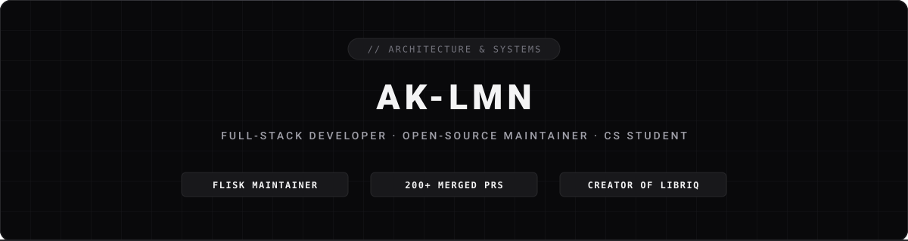

<div align="center">



<br/><br/>

[](https://github.com/flisk-sh/flisk/issues/1164)
[](https://github.com/AK-Lmn)
[](https://hub.xerj.org/contributors/AK-Lmn)
[](https://github.com/sponsors/AK-Lmn)
[](https://ko-fi.com/aklmn)

<br/>

[](https://discord.gg/qMu5Xn8Kaq)
[](https://discord.gg/qMu5Xn8Kaq)
[](https://discord.gg/qMu5Xn8Kaq)

<br/><br/>

``` text
┌── [TELEMETRY] ─────────────────────────────────────────────────────────────┐
│ HOST: ak-lmn@workstation      OS: Archival Kernel      STATUS: 214 MERGED  │
│ FOCUS: Developer Tooling · Runtime Engines · Offline-First Architectures   │
│ LINKS: aklmn.me · linkedin.com/in/kim-lamano · github.com/sponsors/AK-Lmn │
└────────────────────────────────────────────────────────────────────────────┘
```

</div>

<br/>

``` text
┌── [01] SYSTEM PROFILE & MAINTAINER RECORD ────────────────────────────────────────────────────────┐
│                                                                                                   │
│  › IDENTITY       Kim Lamano (@AK-Lmn) · 2nd Year Computer Science Student @ Lyceum of Alabang    │
│  › CORE ROLE      Flisk Maintainer & Reviewer across 66 repositories (flisk-sh ecosystem)         │
│  › RANK           Founding Contributor #3 of 100 · Flisk Elite · Brown Belt (4-1 kyu)             │
│  › MILESTONE      214 Total Merged PRs across 50+ open-source ecosystems (83 in Flisk Core)       │
│  › RECOGNITION    Selected by XERJ Corpus Hub (4.2k+ stars) as an open-source reference solution │
│  › ARCHITECTURE   Offline-first service workers, Three.js 3D spatial runtimes, developer CLIs     │
│                                                                                                   │
└───────────────────────────────────────────────────────────────────────────────────────────────────┘
```

<br/>

### [02] FEATURED ARCHITECTURES & RUNTIMES

<table>
  <tr>
    <td width="50%" valign="top">
      <div align="left">
        <b><code>01 // FLAGSHIP APPLICATION</code></b>
        <h3><b>LibriQ</b> &nbsp;·&nbsp; <code>Three.js · PWA</code></h3>
        <p>Personal 3D digital bookshelf and spatial reading tracker built for high-performance offline environments.</p>
        <ul>
          <li><b>Spatial Canvas:</b> Dynamic Three.js 3D bookshelf rendering with camera animations and custom book shaders.</li>
          <li><b>Data Pipeline:</b> RFC 4180 streaming parser for Goodreads and Kindle CSV libraries.</li>
          <li><b>Durability:</b> Offline-first Service Worker cache with zero cloud dependencies.</li>
        </ul>
        <p>
          <a href="https://libriq.app"><b>[Launch Application]</b></a> &nbsp;·&nbsp; 
          <a href="https://github.com/AK-Lmn/Libriq"><b>Source Code (50 Merged PRs)</b></a>
        </p>
      </div>
    </td>
    <td width="50%" valign="top">
      <div align="left">
        <b><code>02 // SYSTEMS &amp; TOOLING</code></b>
        <h3><b>Flisk CLI Core</b> &nbsp;·&nbsp; <code>Runtime · Systems</code></h3>
        <p>Local multi-service runtime orchestration engine and developer experience infrastructure.</p>
        <ul>
          <li><b>Subcommands:</b> Engineered <code>flisk import tiltfile</code> (#2239) and <code>compose</code> (#2238).</li>
          <li><b>Configurable Gateway:</b> Added optional Traefik ingress &amp; Postgres durability session stores (#2232, #2233).</li>
          <li><b>AI Control Plane:</b> Integrated <code>tdk mcp</code> server interface and standardized JSON envelopes (#707, #4582).</li>
        </ul>
        <p>
          <a href="https://github.com/flisk-sh/flisk"><b>[Ecosystem Core]</b></a> &nbsp;·&nbsp; 
          <a href="https://github.com/flisk-sh/flisk/pulls?q=is%3Apr+author%3AAK-Lmn+is%3Amerged"><b>Merged PRs (83 Core)</b></a>
        </p>
      </div>
    </td>
  </tr>
  <tr>
    <td width="50%" valign="top">
      <div align="left">
        <b><code>03 // MOBILE &amp; HARDWARE</code></b>
        <h3><b>PoopPal</b> &nbsp;·&nbsp; <code>Android · React 19</code></h3>
        <p>Health habit tracking Android application with real-time hardware telemetry and custom audio engines.</p>
        <ul>
          <li><b>Android Integration:</b> Native 2x2 home widgets, Quick Settings tile toggles, and offline-first state.</li>
          <li><b>Audio Synthesis:</b> Procedural chiptune sound generator built with Web Audio API.</li>
          <li><b>Real-time Sync:</b> Peer-to-peer duo tracking with Firebase Firestore latency optimization.</li>
        </ul>
        <p>
          <a href="https://github.com/AK-Lmn/PoopPal/releases/tag/v1.1.0"><b>[Download APK v1.1.0]</b></a> &nbsp;·&nbsp; 
          <a href="https://github.com/AK-Lmn/PoopPal"><b>Source Code</b></a>
        </p>
      </div>
    </td>
    <td width="50%" valign="top">
      <div align="left">
        <b><code>04 // CLINICAL SYSTEMS</code></b>
        <h3><b>Lokal.MD</b> &nbsp;·&nbsp; <code>Python · Clinical EHR</code></h3>
        <p>Offline Taglish speech-to-text EHR vault for Philippine Rural Health Units (RHU).</p>
        <ul>
          <li><b>Audio Engine:</b> Local quantized speech-to-text transcription engine for mixed English/Tagalog dialect.</li>
          <li><b>Security Vault:</b> Deterministic Philippine National Formulary (PNF) validator and AES-256-GCM record encryption.</li>
          <li><b>Hackathon:</b> Engineered during AppBuildersPH Hackathon.</li>
        </ul>
        <p>
          <a href="https://github.com/AK-Lmn/lokal-md"><b>[Source Repository]</b></a> &nbsp;·&nbsp; 
          <i>AppBuildersPH Submission</i>
        </p>
      </div>
    </td>
  </tr>
</table>

<br/>

---

### [03] OPEN SOURCE IMPACT

- **flisk-sh/flisk**: Shipped import commands (`tiltfile`, `compose`), configurable gateways, native log rotations, and runtime envelopes.
- **xerj-org/xerj**: Documented 26 agent harness configurations and execution contracts.
- **determined-001/Quay**: Hardened mainnet secret generator and quote validators.
- **oll4com/spaceapp**: Unified distributed tracing and child-workflow spans over OTLP.

<details>
<summary><b>Complete Pull Request Log (214 Merged PRs across 50+ Ecosystems)</b></summary>
<br/>

#### [`flisk-sh/flisk`](https://github.com/flisk-sh/flisk) (83 Merged in Core)
`›` `[FIX]` &nbsp;·&nbsp; [fix(cli): show tilt master file in flisk info only when it exists (#4434)](https://github.com/flisk-sh/flisk/pull/4714)<br/>
`›` `[FIX]` &nbsp;·&nbsp; [fix(runtime): wrap --check-assets output in the standard JSON envelope (#4467)](https://github.com/flisk-sh/flisk/pull/4582)<br/>
`›` `[FIX]` &nbsp;·&nbsp; [fix(doctor): clarify repair summary when checks need manual action (#4444)](https://github.com/flisk-sh/flisk/pull/4580)<br/>
`›` `[FIX]` &nbsp;·&nbsp; [fix(mcp): report unknown resource names in mcp check (#4445)](https://github.com/flisk-sh/flisk/pull/4579)<br/>
`›` `[FIX]` &nbsp;·&nbsp; [fix(resource): fail early when --register-existing points at a missing folder (#4441)](https://github.com/flisk-sh/flisk/pull/4578)<br/>
`›` `[FIX]` &nbsp;·&nbsp; [fix(stack): reject flag-like --resources values and report USAGE (#4519)](https://github.com/flisk-sh/flisk/pull/4576)<br/>
`›` `[STYLE]` &nbsp;·&nbsp; [style(test): wrap the long npxInvocation call so the Biome formatter passes](https://github.com/flisk-sh/flisk/pull/4575)<br/>
`›` `[FIX]` &nbsp;·&nbsp; [fix(logs): read native log tails from the end and rotate logs at 10 MB (#3720)](https://github.com/flisk-sh/flisk/pull/4505)<br/>
`›` `[FIX]` &nbsp;·&nbsp; [fix(export,import): pass arguments to npx on Windows without cmd.exe splitting them (#4004)](https://github.com/flisk-sh/flisk/pull/4504)<br/>
`›` `[FIX]` &nbsp;·&nbsp; [fix(json): return the USAGE envelope for every parse error under --json (#4246)](https://github.com/flisk-sh/flisk/pull/4503)<br/>
`›` `[FIX]` &nbsp;·&nbsp; [fix(resource): reserve ports across concurrent creates (#4023)](https://github.com/flisk-sh/flisk/pull/4502)<br/>
`›` `[FIX]` &nbsp;·&nbsp; [fix(native): verify process identity before stopping recorded pids (#3960)](https://github.com/flisk-sh/flisk/pull/4501)<br/>
`›` `[FIX]` &nbsp;·&nbsp; [fix(demo): refuse unknown root options such as --dry-run before the demo starts (#4487)](https://github.com/flisk-sh/flisk/pull/4493)<br/>
`›` `[FIX]` &nbsp;·&nbsp; [fix(project): suggest flisk project --check for validate and action words (#4435)](https://github.com/flisk-sh/flisk/pull/4448)<br/>
`›` `[FIX]` &nbsp;·&nbsp; [fix(up): list bring-your-own services at startup (#3203)](https://github.com/flisk-sh/flisk/pull/3285)<br/>
`›` `[FEAT]` &nbsp;·&nbsp; [feat(version): print build commit sha in flisk version --verbose (#3096)](https://github.com/flisk-sh/flisk/pull/3195)<br/>
`›` `[FEAT]` &nbsp;·&nbsp; [feat(manifest): carry over command on services with build (#3060)](https://github.com/flisk-sh/flisk/pull/3194)<br/>
`›` `[TEST]` &nbsp;·&nbsp; [test(cli): add unit test coverage for ui command (#3112)](https://github.com/flisk-sh/flisk/pull/3193)<br/>
`›` `[FEAT]` &nbsp;·&nbsp; [feat(scores): check heading anchors in Markdown links in doc-links gate](https://github.com/flisk-sh/flisk/pull/3020)<br/>
`›` `[FEAT]` &nbsp;·&nbsp; [feat(database): move Postgres behind optional database capability (#2233)](https://github.com/flisk-sh/flisk/pull/2854)<br/>
`›` `[FEAT]` &nbsp;·&nbsp; [feat(gateway): move Traefik behind optional gateway capability (#2232)](https://github.com/flisk-sh/flisk/pull/2853)<br/>
`›` `[FEAT]` &nbsp;·&nbsp; [feat(manifest): make health checks optional and configurable (#2235)](https://github.com/flisk-sh/flisk/pull/2852)<br/>
`›` `[FEAT]` &nbsp;·&nbsp; [feat(cli): add flisk import tiltfile subcommand (#2239)](https://github.com/flisk-sh/flisk/pull/2849)<br/>
`›` `[FEAT]` &nbsp;·&nbsp; [feat(cli): add flisk import compose subcommand (#2238)](https://github.com/flisk-sh/flisk/pull/2848)<br/>
`›` `[TEST]` &nbsp;·&nbsp; [test(scripts): add behaviour test for wsl2-smoke.sh (Fixes #2366)](https://github.com/flisk-sh/flisk/pull/2845)<br/>
`›` `[TEST]` &nbsp;·&nbsp; [test(scripts): add test for hacktoberfest-embed.mjs (Fixes #2323)](https://github.com/flisk-sh/flisk/pull/2844)<br/>
`›` `[TEST]` &nbsp;·&nbsp; [test(scripts): add test for npm-downloads-graph.mjs (Fixes #2322)](https://github.com/flisk-sh/flisk/pull/2843)<br/>
`›` `[TEST]` &nbsp;·&nbsp; [test(scripts): add test for demo-svgs.mjs (Fixes #2328)](https://github.com/flisk-sh/flisk/pull/2842)<br/>
`›` `[TEST]` &nbsp;·&nbsp; [test(scripts): add behaviour test for setup-pre-commit.sh (Fixes #2331)](https://github.com/flisk-sh/flisk/pull/2841)<br/>
`›` `[FIX]` &nbsp;·&nbsp; [fix(scripts): preserve hooks when .githooks is absent](https://github.com/flisk-sh/flisk/pull/2710)<br/>
`›` `[TEST]` &nbsp;·&nbsp; [test(scripts): add behaviour test for sync-byo-templates.sh (Fixes #2368)](https://github.com/flisk-sh/flisk/pull/2660)<br/>
`›` `[TEST]` &nbsp;·&nbsp; [test(scripts): add behaviour test for package-lifecycle-smoke.sh (Fixes #2370)](https://github.com/flisk-sh/flisk/pull/2659)<br/>
`›` `[TEST]` &nbsp;·&nbsp; [test(scripts): add behaviour test for cold-boot-notes.sh (Fixes #2369)](https://github.com/flisk-sh/flisk/pull/2658)<br/>
`›` `[TEST]` &nbsp;·&nbsp; [test(scripts): add behaviour test for release-binaries.sh (Fixes #2372)](https://github.com/flisk-sh/flisk/pull/2657)<br/>
`›` `[TEST]` &nbsp;·&nbsp; [test(scripts): add behaviour test for audit-codebase.sh (Fixes #2371)](https://github.com/flisk-sh/flisk/pull/2656)<br/>
`›` `[TEST]` &nbsp;·&nbsp; [test(cli): add tests for up-only shared infrastructure list (Fixes #2430)](https://github.com/flisk-sh/flisk/pull/2493)<br/>
`›` `[TEST]` &nbsp;·&nbsp; [test(status): cover Traefik ingress rows in status-ports (Fixes #2427)](https://github.com/flisk-sh/flisk/pull/2492)<br/>
`›` `[TEST]` &nbsp;·&nbsp; [test(config): pin TRAEFIK network and ports in platform-standards (Fixes #2428)](https://github.com/flisk-sh/flisk/pull/2491)<br/>
`›` `[TEST]` &nbsp;·&nbsp; [test(down): cover Traefik network marker check in down-cleanup (Fixes #2426)](https://github.com/flisk-sh/flisk/pull/2490)<br/>
`›` `[TEST]` &nbsp;·&nbsp; [test(cli): expand coverage for the generator template engine (#1553)](https://github.com/flisk-sh/flisk/pull/1866)<br/>
`›` `[TEST]` &nbsp;·&nbsp; [test(cli): cover service URL generation and runtime state edges (#1593)](https://github.com/flisk-sh/flisk/pull/1865)<br/>
`›` `[TEST]` &nbsp;·&nbsp; [test(cli): cover custom agent runtime handling (#1552)](https://github.com/flisk-sh/flisk/pull/1864)<br/>
`›` `[TEST]` &nbsp;·&nbsp; [test(cli): cover dependency cycles and empty Tilt payloads in startup reports](https://github.com/flisk-sh/flisk/pull/1809)<br/>
`›` `[TEST]` &nbsp;·&nbsp; [test(cli): cover services metadata, stack metadata, and discovery problems](https://github.com/flisk-sh/flisk/pull/1808)<br/>
`›` `[TEST]` &nbsp;·&nbsp; [test(cli): unit tests for generator/extension-fetch and resource-templates (#1571)](https://github.com/flisk-sh/flisk/pull/1769)<br/>
`›` `[TEST]` &nbsp;·&nbsp; [test(cli): unit tests for MCP backend and agent-session helpers (#1569)](https://github.com/flisk-sh/flisk/pull/1768)<br/>
`›` `[TEST]` &nbsp;·&nbsp; [test(cli): cover project stack syncing and command flow (#1568)](https://github.com/flisk-sh/flisk/pull/1762)<br/>
`›` `[TEST]` &nbsp;·&nbsp; [test(cli): cover env validator parsing and completion edge cases (#1560)](https://github.com/flisk-sh/flisk/pull/1752)<br/>
`›` `[TEST]` &nbsp;·&nbsp; [test(cli): cover Tilt process, startup, and helper edge cases (#1559)](https://github.com/flisk-sh/flisk/pull/1738)<br/>
`›` `[TEST]` &nbsp;·&nbsp; [test(cli): unit tests for utils/shared-infra and shared-platform-postgres (#1565)](https://github.com/flisk-sh/flisk/pull/1699)<br/>
`›` `[TEST]` &nbsp;·&nbsp; [test(cli): unit tests for utils/smoke and health-check helpers (#1561)](https://github.com/flisk-sh/flisk/pull/1698)<br/>
`›` `[TEST]` &nbsp;·&nbsp; [test(cli): unit tests for utils/prompt and suggestion helpers (#1563)](https://github.com/flisk-sh/flisk/pull/1697)<br/>
`›` `[TEST]` &nbsp;·&nbsp; [test(cli): unit tests for utils/cache, single-flight, and atomic-write (#1564)](https://github.com/flisk-sh/flisk/pull/1696)<br/>
`›` `[TEST]` &nbsp;·&nbsp; [test(cli): unit tests for utils/paths, generated-paths, and file helpers (#1562)](https://github.com/flisk-sh/flisk/pull/1695)<br/>
`›` `[DOCS]` &nbsp;·&nbsp; [docs: write docs/comparison.md comparing TDK with alternative dev tools (#105)](https://github.com/flisk-sh/flisk/pull/1684)<br/>
`›` `[DOCS]` &nbsp;·&nbsp; [docs(contributing): add getting help, supported platforms, and TOC (#98)](https://github.com/flisk-sh/flisk/pull/1683)<br/>
`›` `[DOCS]` &nbsp;·&nbsp; [docs: add root AGENTS.md for AI coding agents (#92)](https://github.com/flisk-sh/flisk/pull/1682)<br/>
`›` `[REFACTOR]` &nbsp;·&nbsp; [refactor(cli): standardise error message style and document exit code rules (#708)](https://github.com/flisk-sh/flisk/pull/1620)<br/>
`›` `[FEAT]` &nbsp;·&nbsp; [feat(doctor): add --all flag with Machine/Project sections and summary (#86)](https://github.com/flisk-sh/flisk/pull/1618)<br/>
`›` `[TEST]` &nbsp;·&nbsp; [test(doctor): verify --json check shapes and document flag in cli/README.md (#87)](https://github.com/flisk-sh/flisk/pull/1617)<br/>
`›` `[FEAT]` &nbsp;·&nbsp; [feat(import): enforce core version gate and upgrade recommendation (#634)](https://github.com/flisk-sh/flisk/pull/1365)<br/>
`›` `[DOCS]` &nbsp;·&nbsp; [docs(cli): structure framework version table and tidy spacing (#813)](https://github.com/flisk-sh/flisk/pull/1353)<br/>
`›` `[DOCS]` &nbsp;·&nbsp; [docs: document resource features and featuresEnabled array (#127)](https://github.com/flisk-sh/flisk/pull/1351)<br/>
`›` `[DOCS]` &nbsp;·&nbsp; [docs: write docs/how-tdk-up-works.md explaining lifecycle, flags, and down (#101)](https://github.com/flisk-sh/flisk/pull/1350)<br/>
`›` `[DOCS]` &nbsp;·&nbsp; [docs: write docs/ARCHITECTURE.md explaining CLI, engine, and discovery (#99)](https://github.com/flisk-sh/flisk/pull/1349)<br/>
`›` `[FEAT]` &nbsp;·&nbsp; [feat(backend): add node as a native backend language provider (#110)](https://github.com/flisk-sh/flisk/pull/1276)<br/>
`›` `[FEAT]` &nbsp;·&nbsp; [feat(ui): press 'o' to open resource URL in browser and 'y' to copy it (#456)](https://github.com/flisk-sh/flisk/pull/1269)<br/>
`›` `[FEAT]` &nbsp;·&nbsp; [feat(distribution): add agent directives, skills, and agent-stack template (#1256 part D)](https://github.com/flisk-sh/flisk/pull/1264)<br/>
`›` `[FEAT]` &nbsp;·&nbsp; [feat(mcp): add agent control tools and CLI commands (#1256 part C)](https://github.com/flisk-sh/flisk/pull/1263)<br/>
`›` `[FEAT]` &nbsp;·&nbsp; [feat(agent): add postgres durability session store (#1256)](https://github.com/flisk-sh/flisk/pull/1262)<br/>
`›` `[REFACTOR]` &nbsp;·&nbsp; [refactor(cli): standardise machine envelope construction in machine-output (#707)](https://github.com/flisk-sh/flisk/pull/1261)<br/>
`›` `[DOCS]` &nbsp;·&nbsp; [docs(agents): position TDK for the AI-agent era (#1256 part A)](https://github.com/flisk-sh/flisk/pull/1260)<br/>
`›` `[DOCS]` &nbsp;·&nbsp; [docs(cli): document tdk up --json readiness result (#1195)](https://github.com/flisk-sh/flisk/pull/1226)<br/>
`›` `[FIX]` &nbsp;·&nbsp; [fix(cli): do not pass --force to tilt down (#1216)](https://github.com/flisk-sh/flisk/pull/1225)<br/>
`›` `[REFACTOR]` &nbsp;·&nbsp; [refactor: use constant for project.json file name (#905)](https://github.com/flisk-sh/flisk/pull/950)<br/>
`›` `[REFACTOR]` &nbsp;·&nbsp; [refactor: use constant for TILT_TECH_STACK.star file name (#908)](https://github.com/flisk-sh/flisk/pull/949)<br/>
`›` `[REFACTOR]` &nbsp;·&nbsp; [refactor: use constant for TILT_RESOURCE_DEFAULTS.star file name (#909)](https://github.com/flisk-sh/flisk/pull/948)<br/>
`›` `[REFACTOR]` &nbsp;·&nbsp; [refactor: use constant for .autogenerated directory name (#907)](https://github.com/flisk-sh/flisk/pull/947)<br/>
`›` `[REFACTOR]` &nbsp;·&nbsp; [refactor: constant for the package.json file name (#906)](https://github.com/flisk-sh/flisk/pull/946)<br/>
`›` `[REFACTOR]` &nbsp;·&nbsp; [refactor: constant for the docker-compose.yml file name (#910)](https://github.com/flisk-sh/flisk/pull/945)<br/>
`›` `[DOCS]` &nbsp;·&nbsp; [docs(cli): document up, down and status flags](https://github.com/flisk-sh/flisk/pull/660)<br/>
`›` `[DOCS]` &nbsp;·&nbsp; [docs(cli): document tdk doctor --no-ping and --ping-timeout flags](https://github.com/flisk-sh/flisk/pull/659)<br/>
`›` `[TEST]` &nbsp;·&nbsp; [test(cli): cover env-validator utility functions](https://github.com/flisk-sh/flisk/pull/658)<br/>

#### [`flisk-sh/flisk-labs`](https://github.com/flisk-sh/flisk-labs) &nbsp;·&nbsp; [`flisk-sh/releases`](https://github.com/flisk-sh/releases)
`›` `[TEST]` &nbsp;·&nbsp; [test(validate): verify that every catalog lab_id exists in content/labs (#10)](https://github.com/flisk-sh/flisk-labs/pull/50)<br/>
`›` `[CI]` &nbsp;·&nbsp; [ci(releases): notify Scoop on published Flisk releases](https://github.com/flisk-sh/releases/pull/18)<br/>

#### [`xerj-org/xerj`](https://github.com/xerj-org/xerj)
`›` `[DOCS]` &nbsp;·&nbsp; [docs: list 26 supported agent harnesses (#1991)](https://github.com/xerj-org/xerj/pull/2109)<br/>
`›` `[DOCS]` &nbsp;·&nbsp; [docs: sign the CLA by adding AK-Lmn to .contributors](https://github.com/xerj-org/xerj/pull/2108)<br/>

#### [`determined-001/Quay`](https://github.com/determined-001/Quay)
`›` `[FIX]` &nbsp;·&nbsp; [fix(ops): stop generating DEFAULT_SELLER keys in gen-mainnet-secrets (#417)](https://github.com/determined-001/Quay/pull/426)<br/>
`›` `[FIX]` &nbsp;·&nbsp; [fix(api): validate and normalize targetCurrency on cash-out quote route (#412)](https://github.com/determined-001/Quay/pull/425)<br/>

#### [`FixITSukil/findmy-trail`](https://github.com/FixITSukil/findmy-trail)
`›` `[FEAT]` &nbsp;·&nbsp; [feat: implement live trail statistics panel inside sidebar dashboard](https://github.com/FixITSukil/findmy-trail/pull/26)<br/>
`›` `[FEAT]` &nbsp;·&nbsp; [feat: sync map layer tiles dynamically with application theme toggle](https://github.com/FixITSukil/findmy-trail/pull/25)<br/>
`›` `[FEAT]` &nbsp;·&nbsp; [feat: add timeline playback scrubber controls for tracking simulation](https://github.com/FixITSukil/findmy-trail/pull/24)<br/>
`›` `[FEAT]` &nbsp;·&nbsp; [feat: add date range filter listeners and real-time layout updates](https://github.com/FixITSukil/findmy-trail/pull/18)<br/>
`›` `[FEAT]` &nbsp;·&nbsp; [feat: support Google Takeout Records.json timeline format auto-detection](https://github.com/FixITSukil/findmy-trail/pull/17)<br/>
`›` `[FEAT]` &nbsp;·&nbsp; [feat: implement full keyboard navigation and accessibility enhancements](https://github.com/FixITSukil/findmy-trail/pull/16)<br/>
`›` `[FEAT]` &nbsp;·&nbsp; [feat: implement comprehensive Google Maps Timeline JSON parser](https://github.com/FixITSukil/findmy-trail/pull/6)<br/>

#### [`anoopcodehack/DevBoard`](https://github.com/anoopcodehack/DevBoard)
`›` `[FEAT]` &nbsp;·&nbsp; [feat: add flip animation when task status changes (#545)](https://github.com/anoopcodehack/DevBoard/pull/570)<br/>
`›` `[FEAT]` &nbsp;·&nbsp; [feat: show previous assignees on task card and modal (#564)](https://github.com/anoopcodehack/DevBoard/pull/569)<br/>
`›` `[FEAT]` &nbsp;·&nbsp; [feat: add subtle status-based tints to task cards (#488)](https://github.com/anoopcodehack/DevBoard/pull/568)<br/>
`›` `[FEAT]` &nbsp;·&nbsp; [feat: export task details as Markdown file (#526)](https://github.com/anoopcodehack/DevBoard/pull/567)<br/>
`›` `[FEAT]` &nbsp;·&nbsp; [feat: add font size toggle on code snippets (#565)](https://github.com/anoopcodehack/DevBoard/pull/566)<br/>

#### [`embedcatalog/embedcatalog`](https://github.com/embedcatalog/embedcatalog)
`›` `[FEAT]` &nbsp;·&nbsp; [feat(ui): make tags clickable in Other Projects section](https://github.com/embedcatalog/embedcatalog/pull/20)<br/>
`›` `[FEAT]` &nbsp;·&nbsp; [feat(ui): make project tags clickable with search filter](https://github.com/embedcatalog/embedcatalog/pull/19)<br/>
`›` `[FIX]` &nbsp;·&nbsp; [fix(ui): remove underline on link hover in submit page](https://github.com/embedcatalog/embedcatalog/pull/18)<br/>
`›` `[CONTRIB]` &nbsp;·&nbsp; [Add search component to embeds page (#2)](https://github.com/embedcatalog/embedcatalog/pull/5)<br/>

#### [`brekkylab/backlot`](https://github.com/brekkylab/backlot)
`›` `[CONTRIB]` &nbsp;·&nbsp; [notion: a person's person member includes email_verified](https://github.com/brekkylab/backlot/pull/635)<br/>
`›` `[CONTRIB]` &nbsp;·&nbsp; [s3: object GET and HEAD send default AES256 server-side encryption on 200 and 206](https://github.com/brekkylab/backlot/pull/600)<br/>
`›` `[CONTRIB]` &nbsp;·&nbsp; [jira: serverInfo lists its members in real's order](https://github.com/brekkylab/backlot/pull/519)<br/>

#### [`cleanor-app/search-index`](https://github.com/cleanor-app/search-index)
`›` `[FEAT]` &nbsp;·&nbsp; [feat(analysis): add image format demand analysis notebook](https://github.com/cleanor-app/search-index/pull/11)<br/>
`›` `[FEAT]` &nbsp;·&nbsp; [feat(validate): check derived CSVs for share sum and rank consistency](https://github.com/cleanor-app/search-index/pull/10)<br/>

#### [`TechGenDM/OpenField`](https://github.com/TechGenDM/OpenField)
`›` `[FEAT]` &nbsp;·&nbsp; [feat: add client-side markdown and json report export (#1)](https://github.com/TechGenDM/OpenField/pull/6)<br/>

#### [`StackGuardian/tirith`](https://github.com/StackGuardian/tirith)
`›` `[TEST]` &nbsp;·&nbsp; [test(evaluators): cover IsEmpty and IsNotEmpty on 0, False and whitespace](https://github.com/StackGuardian/tirith/pull/409)<br/>

#### [`TheVicky1/Pact_OS`](https://github.com/TheVicky1/Pact_OS)
`›` `[TEST]` &nbsp;·&nbsp; [test: write comprehensive unit test suite for number range clamp helper (#431)](https://github.com/TheVicky1/Pact_OS/pull/444)<br/>

#### [`SumantxD/shrike`](https://github.com/SumantxD/shrike)
`›` `[FIX]` &nbsp;·&nbsp; [fix(routes): stop polling for spec indefinitely and use finite backoff](https://github.com/SumantxD/shrike/pull/49)<br/>

#### [`nikolas-sapa/ns-ui`](https://github.com/nikolas-sapa/ns-ui)
`›` `[DOCS]` &nbsp;·&nbsp; [docs: refresh stale component counts in live code comments](https://github.com/nikolas-sapa/ns-ui/pull/87)<br/>

#### Extended Ecosystem Contributions
<details>
<summary><b>Expand all additional open-source contributions (32 Merged PRs)</b></summary>
<br/>

`›` [`chrisaph/speculara`](https://github.com/chrisaph/speculara) &nbsp;·&nbsp; `[CONTRIB]` &nbsp;·&nbsp; [Start shared Speculara integration](https://github.com/chrisaph/speculara/pull/1)<br/>
`›` [`reticlehq/reticle`](https://github.com/reticlehq/reticle) &nbsp;·&nbsp; `[FIX]` &nbsp;·&nbsp; [fix(tune): branch tune hud diagnostics on sdkVersion and session id](https://github.com/reticlehq/reticle/pull/1591)<br/>
`›` [`pablocaeg/sloptotal`](https://github.com/pablocaeg/sloptotal) &nbsp;·&nbsp; `[CONTRIB]` &nbsp;·&nbsp; [documents: extract text from Word tables when parsing .docx](https://github.com/pablocaeg/sloptotal/pull/130)<br/>
`›` [`pablocaeg/sloptotal`](https://github.com/pablocaeg/sloptotal) &nbsp;·&nbsp; `[CONTRIB]` &nbsp;·&nbsp; [accessibility: announce file upload status with aria-live and role=status](https://github.com/pablocaeg/sloptotal/pull/129)<br/>
`›` [`Vedantgitbot/booth`](https://github.com/Vedantgitbot/booth) &nbsp;·&nbsp; `[FEAT]` &nbsp;·&nbsp; [feat(typing): add py.typed marker and package data (PEP 561)](https://github.com/Vedantgitbot/booth/pull/16)<br/>
`›` [`Ergane-Foundation/vajra`](https://github.com/Ergane-Foundation/vajra) &nbsp;·&nbsp; `[FIX]` &nbsp;·&nbsp; [fix(federated): import Any and pass --eve-path to alert reader](https://github.com/Ergane-Foundation/vajra/pull/32)<br/>
`›` [`vieanderes/understory`](https://github.com/vieanderes/understory) &nbsp;·&nbsp; `[FEAT]` &nbsp;·&nbsp; [feat(assistant): add OpenAI-compatible provider for Scout](https://github.com/vieanderes/understory/pull/31)<br/>
`›` [`Avenx-JS/avenx-js`](https://github.com/Avenx-JS/avenx-js) &nbsp;·&nbsp; `[DOCS]` &nbsp;·&nbsp; [docs: document server.headers configuration option (#1443)](https://github.com/Avenx-JS/avenx-js/pull/1447)<br/>
`›` [`basitalisandhu/security-actions`](https://github.com/basitalisandhu/security-actions) &nbsp;·&nbsp; `[FEAT]` &nbsp;·&nbsp; [feat(llms-txt-check): add --sorted flag and LLMS-015 rule (#5)](https://github.com/basitalisandhu/security-actions/pull/9)<br/>
`›` [`hussnainahmedd/bloodlink`](https://github.com/hussnainahmedd/bloodlink) &nbsp;·&nbsp; `[TEST]` &nbsp;·&nbsp; [test: add Vitest and unit tests for 8x8 blood compatibility matrix (#5)](https://github.com/hussnainahmedd/bloodlink/pull/25)<br/>
`›` [`osmanahmadxai/beemr`](https://github.com/osmanahmadxai/beemr) &nbsp;·&nbsp; `[FEAT]` &nbsp;·&nbsp; [feat(share): add --copy option to copy ticket to clipboard](https://github.com/osmanahmadxai/beemr/pull/7)<br/>
`›` [`osmanahmadxai/beemr`](https://github.com/osmanahmadxai/beemr) &nbsp;·&nbsp; `[FEAT]` &nbsp;·&nbsp; [feat(progress): show estimated time remaining](https://github.com/osmanahmadxai/beemr/pull/6)<br/>
`›` [`ch0sn/kin-graph`](https://github.com/ch0sn/kin-graph) &nbsp;·&nbsp; `[CONTRIB]` &nbsp;·&nbsp; [Split GEDCOM export lines over 255 characters with CONC/CONT (#22)](https://github.com/ch0sn/kin-graph/pull/23)<br/>
`›` [`qorud02/public-data-sentinel`](https://github.com/qorud02/public-data-sentinel) &nbsp;·&nbsp; `[CONTRIB]` &nbsp;·&nbsp; [Keep column names literal in Markdown reports (#4)](https://github.com/qorud02/public-data-sentinel/pull/5)<br/>
`›` [`FirelyTeam/firely-cql-sdk`](https://github.com/FirelyTeam/firely-cql-sdk) &nbsp;·&nbsp; `[FIX]` &nbsp;·&nbsp; [fix(CqlToElm): fix TypeFoundIsNotExpected argument order and remove stray quote (#1750)](https://github.com/FirelyTeam/firely-cql-sdk/pull/1752)<br/>
`›` [`StaveIndustries/woo-pay`](https://github.com/StaveIndustries/woo-pay) &nbsp;·&nbsp; `[FIX]` &nbsp;·&nbsp; [fix(settings): validate wallet address before saving (#1)](https://github.com/StaveIndustries/woo-pay/pull/21)<br/>
`›` [`doobidoo/mcp-memory-service`](https://github.com/doobidoo/mcp-memory-service) &nbsp;·&nbsp; `[DOCS]` &nbsp;·&nbsp; [docs: fix commands and options in chromadb-migration.md (#1421)](https://github.com/doobidoo/mcp-memory-service/pull/1422)<br/>
`›` [`fork-commit-merge/fork-commit-merge`](https://github.com/fork-commit-merge/fork-commit-merge) &nbsp;·&nbsp; `[FEAT]` &nbsp;·&nbsp; [feat(tailwind): style responsive card component in easy task](https://github.com/fork-commit-merge/fork-commit-merge/pull/8342)<br/>
`›` [`speedyk-005/yasbd-lib`](https://github.com/speedyk-005/yasbd-lib) &nbsp;·&nbsp; `[CONTRIB]` &nbsp;·&nbsp; [Address false splits by adding párrf and párr to the Spanish reference abbreviations](https://github.com/speedyk-005/yasbd-lib/pull/355)<br/>
`›` [`shadcn-labs/shadcn-labs.com`](https://github.com/shadcn-labs/shadcn-labs.com) &nbsp;·&nbsp; `[FEAT]` &nbsp;·&nbsp; [feat: add search box and project filter to /issues (#13)](https://github.com/shadcn-labs/shadcn-labs.com/pull/21)<br/>
`›` [`chinmaypurav/genealogy`](https://github.com/chinmaypurav/genealogy) &nbsp;·&nbsp; `[FIX]` &nbsp;·&nbsp; [fix: remove unused /api/user endpoint and api routing (#15)](https://github.com/chinmaypurav/genealogy/pull/31)<br/>
`›` [`Tboypro/php-mkv-player-media-player-`](https://github.com/Tboypro/php-mkv-player-media-player-) &nbsp;·&nbsp; `[FEAT]` &nbsp;·&nbsp; [feat: add keyboard shortcuts help panel and toggle button (#4)](https://github.com/Tboypro/php-mkv-player-media-player-/pull/5)<br/>
`›` [`Dome-Works/DOME`](https://github.com/Dome-Works/DOME) &nbsp;·&nbsp; `[FEAT]` &nbsp;·&nbsp; [feat: add total used volume size badge on stacks and in detail pane (#89)](https://github.com/Dome-Works/DOME/pull/95)<br/>
`›` [`shadcn-labs/shadcn-labs.com`](https://github.com/shadcn-labs/shadcn-labs.com) &nbsp;·&nbsp; `[FEAT]` &nbsp;·&nbsp; [feat(issues): cap repo groups at 10 with a collapsible toggle (#15)](https://github.com/shadcn-labs/shadcn-labs.com/pull/19)<br/>
`›` [`moteos/loopwise-web`](https://github.com/moteos/loopwise-web) &nbsp;·&nbsp; `[FIX]` &nbsp;·&nbsp; [fix(header): prevent mobile nav wrapping at 390px viewport](https://github.com/moteos/loopwise-web/pull/9)<br/>
`›` [`Justice989810/Pulse-Layer`](https://github.com/Justice989810/Pulse-Layer) &nbsp;·&nbsp; `[FIX]` &nbsp;·&nbsp; [fix: handle clipboard permissions, fallback, and timer cleanup in account audit modal](https://github.com/Justice989810/Pulse-Layer/pull/103)<br/>
`›` [`hariharapanigrahy/layerkit`](https://github.com/hariharapanigrahy/layerkit) &nbsp;·&nbsp; `[FEAT]` &nbsp;·&nbsp; [feat(cli): handle 0 maps gracefully in map list and doctor with guida…](https://github.com/hariharapanigrahy/layerkit/pull/120)<br/>
`›` [`shalintripathi/organic-os`](https://github.com/shalintripathi/organic-os) &nbsp;·&nbsp; `[DOCS]` &nbsp;·&nbsp; [docs: sync command reference table and update test count inventory](https://github.com/shalintripathi/organic-os/pull/9)<br/>
`›` [`bitflicker64/Termstory`](https://github.com/bitflicker64/Termstory) &nbsp;·&nbsp; `[FIX]` &nbsp;·&nbsp; [fix: catch specific ValueError instead of broad Exception in shlex split](https://github.com/bitflicker64/Termstory/pull/162)<br/>
`›` [`homayounmmdy/Lingoo`](https://github.com/homayounmmdy/Lingoo) &nbsp;·&nbsp; `[CONTRIB]` &nbsp;·&nbsp; [Add entry for 'waiter' in level-based words JSON](https://github.com/homayounmmdy/Lingoo/pull/81)<br/>
`›` [`sajansonkar-cmd/Mr-share`](https://github.com/sajansonkar-cmd/Mr-share) &nbsp;·&nbsp; `[FEAT]` &nbsp;·&nbsp; [feat: redesign landing page for modern visual hierarchy](https://github.com/sajansonkar-cmd/Mr-share/pull/11)<br/>
`›` [`Harsh-vardhan09/AthLead`](https://github.com/Harsh-vardhan09/AthLead) &nbsp;·&nbsp; `[FEAT]` &nbsp;·&nbsp; [feat: add range hints and helper text to score input fields](https://github.com/Harsh-vardhan09/AthLead/pull/63)<br/>

</details>

</details>

---

---

### [04] TECHNICAL ARSENAL

``` text
┌── LANGUAGES ─────── TypeScript · JavaScript · Python · Kotlin · SQL · Starlark · Bash ──────────┐
│   FRONTEND ──────── React 19 · Next.js · Vue · Three.js · Tailwind CSS · Vite                   │
│   BACKEND & DB ──── Node.js · Express · FastAPI · PostgreSQL · SQLite / SQLCipher · Firebase   │
│   SYSTEMS & TOOL ── Docker · Tilt · Traefik · FastMCP · GitHub Actions · Vitest · Biome        │
└─────────────────────────────────────────────────────────────────────────────────────────────────┘
```

---

### [05] ENGINEERING TELEMETRY

<div align="center">

| Metric | Measurement | Verification Scope | Status |
| :--- | :---: | :--- | :---: |
| **Total Lifetime Contributions** | **2,000+** | GitHub Global Activity Graph | VERIFIED |
| **Merged Pull Requests** | **214** | 50+ Public Production Ecosystems | ACHIEVED |
| **Core Flisk Contributions** | **83** | Main CLI &amp; Multi-Service Orchestrator | MAINTAINER |
| **Flisk Ecosystem Collaboration** | **66 Repositories** | Review Authority &amp; Write Access | AUTHORIZED |

<br/>


&nbsp;


<br/><br/>

``` text
[SESSION_TERMINATED: ALL_SYSTEMS_OPERATIONAL] // 2026-11-20
```

</div>